# FinCompliance: the full flow, phase by phase

**What this is:** the whole FinCompliance flow in plain words, following one example company from the first request to the filed return. It is written for developers who are new to accounting.
**Companion:** [`FIN_BUILD_PLAN.md`](FIN_BUILD_PLAN.md) is the tracker (task ids, checks, open decisions). Task ids such as F1.4 point there.
**As of:** 2026-10-12. Each phase ends with a **Status** line saying what is built today and what is still planned.
**Decided 2026-10-12 (10x): BiB is not the books.** The client's own software (Tally, Zoho Books, Xero or QuickBooks) holds the books, and BiB posts journals into it. Phases E and G below are written for that.

## Contents

1. [The big picture](#1-the-big-picture)
2. [The example we follow](#2-the-example-we-follow)
3. [Phase A · Trigger](#phase-a--trigger)
4. [Phase B · Collect](#phase-b--collect)
5. [Phase C · Read](#phase-c--read)
6. [Phase D · Review](#phase-d--review)
7. [Phase E · Books](#phase-e--books)
8. [Phase F · Check](#phase-f--check)
9. [Phase G · Post and prepare](#phase-g--post-and-prepare)
10. [Phase H · Verify and file](#phase-h--verify-and-file)
11. [Phase I · Close](#phase-i--close)
12. [Always on · Law watch](#always-on--law-watch)
13. [Proving it works: the scorecard](#proving-it-works-the-scorecard)
14. [Status at a glance](#status-at-a-glance)
15. [Open decisions that change this flow](#open-decisions-that-change-this-flow)
16. [Glossary](#glossary)
17. [Appendix: the diagram](#appendix-the-diagram)

---

## 1. The big picture

Every month a client sends its "books files": invoices, bank statements, expense claims, payroll sheets. Fin reads them, turns them into accounting entries, checks them, and prepares the statutory returns (GST, CPF, withholding tax and so on). People at the firm review, approve and file.

| Phase | In one line |
|---|---|
| **A · Trigger** | The calendar knows what each client must file and when. At month end a job opens and the client is asked for its files. |
| **B · Collect** | The client uploads. If they don't, reminders go out, and late work escalates inside the firm. |
| **C · Read** | Each file is taken in and routed to the right reader. Every document becomes a standard transaction line. |
| **D · Review** | Confident lines pass as a batch. A person checks only the doubtful fields, then commits. |
| **E · Books** | Committed lines become balanced double-entry journals, the bank is reconciled, and BiB proves its own figures add up. |
| **F · Check** | Fixed rules and comparisons with history flag problems. A person decides each one. |
| **G · Post and prepare** | A person approves the month's journals, and BiB posts them into the client's own software. Returns are drafted from the same journals, and the system may send hints (signals) to the Key Manager. |
| **H · Verify and file** | A second person checks the work. A person files on the government portal. |
| **I · Close** | The client sees it filed, the period is billed, and the next month starts. |
| **Law watch** (always on) | Law changes are spotted daily and become rule changes only after a second partner approves. |

### The ground rules (from v3.2, not re-debated per task)

1. **Rules and arithmetic decide. AI only reads documents and drafts.** Coding, posting, reconciliation and checks are deterministic code.
2. **A machine may say "check this". Only a person commits.** Only a person decides that a filing applies to a client, and only a person files a return.
3. **Nothing a machine detects becomes an active rule by itself.** One person proposes, a *different* person approves, and a database CHECK enforces it.
4. **Fin can fail without BiB failing.** See the developer view below.

### Who does what

The diagram uses four colours, and this document uses the same four words:

- **System**: rules and arithmetic. Deterministic, testable, the same answer every time.
- **AI**: reads a document and proposes field values. Nothing else.
- **Person**: anything that commits, decides, approves or files.
- **Client**: what the client sees and does on their portal.

### How fin sits inside BiB (developer view)

- **Separate code:** fin lives in `src/domain/fin/`, `src/usecase/fin/` and `src/infrastructure/fin/`. A dependency-cruiser rule (`core-never-imports-fin`) fails the build if core imports fin. Only a few seams wire it in: `setup/fin.ts`, `setup/server.ts`, `api/router.ts`, `api/domainerr.ts` and `cmd/fin-once.ts`.
- **Separate data:** fin has its own Postgres schema, `fin`. Every fin table has `tenant_id`, RLS and composite `(id, tenant_id)` keys, like the rest of BiB.
- **Separate process:** fin runs as `npm run fin:once` (one pass of every sweep, then exit). It has its own small connection pool (3, max 10) and statement timeouts. In QA it becomes a Cloud Run Job on a schedule (planned, F0.9).
- **Two switches:** `BIB_FIN_ENABLED` (global, off by default) and `tenancy.tenant.fin_enabled_since` (per firm; NULL means off). The instant a firm is switched on is also the cut-off: files uploaded before it are never taken in.
- **Core keeps working with fin off.** Asking clients for files (request templates and asks) and the compliance calendar live in **core**, not fin.
- **Fin never writes core tables directly.** When fin needs core to act, for example to "ask the client", it goes through a port to the core service (`ClientAskService`).

---

## 2. The example we follow

**Company A**, a client of the firm 10x, in Singapore:

| Fact | Value |
|---|---|
| GST registered | Yes, at 9% |
| Employees | 5 |
| Financial year end | 31 December |
| Books kept in | Zoho Books, the client's own software. BiB posts journals into it (the example could equally be Tally, Xero or QuickBooks). |
| Opening position | S$50,000 in the bank, put in by the owner as capital |
| Month | **October 2025** |

Company A's files for October:

| File | What it is | Format |
|---|---|---|
| **INV-101** | A sale to customer **Kopi Ltd**: S$10,000 + 9% GST S$900 = **S$10,900**, dated 5 Oct | Digital PDF |
| **CleanCo CC-5531** | A purchase from vendor **CleanCo**: S$1,000 + GST S$90 = **S$1,090**, dated 8 Oct | Phone photo (JPG) |
| **DBS statement, October** | +10,900 from Kopi (20 Oct), −1,090 to CleanCo (25 Oct), −15 service charge (31 Oct). Closing balance **59,795** | CSV |

The numbers are kept small on purpose, so that every total can be checked by hand.

---

## Phase A · Trigger

**Goal:** know what each client owes the government and when, and ask the client for the month's files at the right time.

### A1. The compliance calendar

Two words matter here, and the whole design depends on keeping them apart:

- An **obligation** (a "filing") is what the **law** requires of a company. For example: "Company A must file GST F5 for Oct–Dec by 31 Jan".
- A **task** is what somebody at the **firm** must do about it.

**Nobody types calendar entries.** The calendar is *generated* from three things:

1. **Rules.** Each rule is one statutory filing: its country, how often it recurs, the formula for its due date, and whose year it follows (the rule's own calendar, the client's year end, or a period the tax authority assigned the client). A rule pack seeds the rules, and a **partner must confirm** each one before it generates anything.
2. **The service link.** A rule reaches a client only if it is linked, in the catalogue, to a service the client has actually bought. This stops a bookkeeping-only client getting GST filings.
3. **The client's compliance profile** (planned, F6.1): year end, first GST quarter end, GST registered, has employees, has foreign employees, pays non-residents, audit required, financial statements filing required. Only a person sets it. Rules can then carry conditions, for example "CPF only if the client has employees" (F6.2).

Each generated filing has **two dates**:

- **Statutory due date:** the law's date. Missing it costs the client money.
- **Internal target, T–X:** the firm's own earlier date, for example 7 days before. This is the date that actually drives work.

**Example.** Company A's calendar might include the following (illustrative only; the real list is 10x's 30 rules, each confirmed by a partner):

| Filing | Period | Due |
|---|---|---|
| CPF contributions | October 2025 | 14 Nov 2025 |
| GST F5 | Oct–Dec 2025 | 31 Jan 2026 |
| ECI (estimated chargeable income) | FY2025 | within 3 months of year end, so 31 Mar 2026 |
| ACRA annual return | FY2025 | within 7 months of year end, so 31 Jul 2026 |
| Form C-S | YA2026 | 30 Nov 2026 |

If Company A had no employees, the CPF filing would simply not be generated.

### A2. The month's job opens

- Company A signed an engagement for a recurring service, for example "Monthly bookkeeping". Every period of that engagement gets a **job**.
- The job walks the firm's own **process** (a `workflow_template`: steps such as collect, reconcile, prepare, review). The process is **pinned** when the period ends, so editing the process later never changes a job already running.
- The job is never due after the earliest legal filing date of its period.
- Its steps land on the right desk through the **owner rule**: the client's SPOC for that Dept, else the Key Manager, else the signing partner.

### A3. The client is asked

- One of the process steps names a **request template**, for example "Monthly close". This is a firm's standing list of what to ask the client for every period, each item with two offsets counted from the period's **last day**:
  - `sendOffsetDays`: when to ask.
  - `dueOffsetDays`: when it is due.
- The **requests sweep** raises one ask per item on the client's portal on the send day. It is idempotent: running it twice raises nothing twice.

**Example.** "Monthly close" asks for sales invoices, purchase invoices, bank statements and expense claims, each filed as document kind `books_input`, sent 1 day and due 5 days after the period ends. October ends on 31 Oct, so Company A is **asked on 1 Nov, due 5 Nov**.

**Developer pointers:** config kinds `request_template` (0384) and `workflow_template`; `client_ask.due_on` and the template link (0385); `RequestSweepService` on the `delivery.requests` queue; calendar tables `delivery.obligation_*`.

**Status:** the calendar engine is **built** (core). Request templates, the sweep and due dates are **built** (F1.1–F1.4, F1.7). A draft Singapore rule pack exists but is unconfirmed. The client profile, rule conditions and 10x's 30 rules are **planned** (F6).

---

## Phase B · Collect

**Goal:** get the files in, chase politely, and tell the right people at the firm when time is running out.

### B1. The client uploads

- The client opens the ask on their portal and uploads. Files are stored as `books_input`, which is the only kind fin reads.
- **Planned (F1.6):** several files on one ask, and staff uploading **on the client's behalf** (files that came by email or by hand).

### B2. Reminders to the client (the chaser)

- The firm writes its own ladder (config kind `chaser`), for example D+3, D+7, D+15. Days are counted **from when the client was asked**.
- Each reminder shows on the client's portal ("last reminded on…"). It stops as soon as the client answers.
- A **freeze** on a client (for example during a fee dispute) stops reminders.
- **Nothing is seeded.** A firm that publishes no ladder sends no reminders.
- **Today reminders appear on the portal only; nothing is emailed.** Whether to add a "you have new requests" email is an open decision.

### B3. Nudges before the legal date

- A separate ladder (config kind `nudge`), for example T–7, T–3, T–1. It counts **backwards from the statutory due date** of a filing, for example "Your GST F5 is due in 3 days".
- It is **not** stopped by a freeze, because the date is the law's, not the firm's.

### B4. Escalation inside the firm

- The escalation ladder (config kind `escalation`) watches the firm's own dates: a task past its due date, work nobody holds, and a filing past its **internal target (T–X)** while the legal date is still ahead.
- It tells the task's holder, then their manager, or anyone at or above a grade.
- It **never acts**: it does not reassign or move anything. It only tells people.

### B5. If the legal date passes: the partner decides

- An unfiled filing past its statutory date becomes **Missed** and goes to the partner's decision queue.
- The options are the firm's own list, for example provisional filing, late fee, nil return, or not applicable. A **reason is mandatory**.
- Only someone with `obligation:resolve` decides (Partner by default).

**Example.** Company A was asked on 1 Nov. By 4 Nov nothing has arrived, so the D+3 reminder shows on the portal. On 6 Nov the client uploads the four items, one day after the 5 Nov due date. If the CPF filing's internal target (say 9 Nov) had passed with the files still missing, the job's owner and then their manager would have been told.

**Status:** the chaser, nudge, escalation and missed-deadline decisions are **built** (core). The due date is shown on staff screens; the portal walk with a real client is pending (F1.5). Multi-file and on-behalf upload are **planned** (F1.6).

---

## Phase C · Read

**Goal:** turn any file, whatever its format, into the same standard transaction line, and never lose a file.

### C1. Intake

- The fin job picks up every new **file version** of kind `books_input` in firms with fin switched on. It creates **exactly one intake item per version**, so re-running the job never duplicates anything. It works in batches of 200 per firm per run.
- It keeps a pointer to the exact version it took in, so "what did fin read?" always has an answer.
- Today this runs through `npm run fin:once`. **Planned:** a Cloud Run Job every 10 minutes (F0.9).
- Staff see everything taken in on the **Files received** screen (`/fin/intake`).

### C2. The router

The declared media type wins. A generic type (phones often send `application/octet-stream`) falls back to the file extension. If neither is recognised, the file goes to `manual`. **A file is never discarded.**

| Route | Files |
|---|---|
| `sheet` | csv, tsv, xls, xlsx, xlsm |
| `pdf` | pdf |
| `image` | jpg, jpeg, png, heic, heif, webp, tif, tiff |
| `archive` | zip |
| `manual` | anything else (for example the pack's `company_profile.json`) |

The route and what decided it (media type, extension or none) are stored on the row, so every routing decision can be explained later.

### C3. The readers (planned)

- **Sheet reader:** it remembers a column map per layout (`fin.source_format`), so the second file in a known layout needs no mapping. It also checks **control totals**: if the lines don't add up to the total printed on the sheet, that becomes a finding.
- **AI extraction (PDF and image):** the only place AI is used in the whole flow.
  - It sits behind a port. The real adapter calls Claude using tool use with a JSON schema; a deterministic fake is used in tests.
  - The output is validated with zod. If it is invalid, the call is **retried once**, then the file goes to `manual`.
  - Safety limits: a circuit breaker, a cap on items per run, and a **monthly budget cap**.
  - Every call records the model, prompt version and tokens used (`fin.extraction_usage`), so "extraction got worse in March" can be traced to a cause.
  - For a digital PDF the text is pulled out first; for a scan or photo the AI reads the image. The scorecard decides which model reads which format, not a guess up front.
- **Archive:** size, count and depth limits, and executables are refused. Each file inside is routed again.
- **Manual desk:** a person keys the document in by hand.
- **Special readers** for the training pack:
  - Bank statements: 5 PDF and 5 CSV layouts, including scanned months. Opening balance, closing balance and line count must match.
  - Card statements: foreign-currency lines and overseas fees.
  - Payroll: 5 Excel templates (formulas read as values) and CPF submission CSVs.
  - Company C's daily POS CSVs and Company B's customs permits.

### C4. The standard transaction line

Every document, whatever its format, ends up as rows in `fin.transaction_line`:

- doc type, counterparty, GST registration number, doc number, date
- currency and SGD rate, net, GST code, GST, total
- service period and credit-note reference
- **provenance:** which document version, page and row it came from

Provenance means every number in the books can be traced back to the exact place on the exact file it was read from.

**Example.**

| File | Route | Result |
|---|---|---|
| INV-101 (PDF) | `pdf` → AI | 1 line: sales invoice, Kopi Ltd, INV-101, 5 Oct, net 10,000, GST code SR, GST 900, total 10,900, page 1 |
| CleanCo photo (JPG) | `image` → AI | 1 line: purchase invoice, CleanCo, CC-5531, 8 Oct, net 1,000, GST 90, total 1,090. **The GST number is blurry.** |
| DBS statement (CSV) | `sheet` | 3 bank lines (+10,900, −1,090, −15). The opening, closing and line count check out. |

**Status:** intake and the router are **built** (F2.1, F2.2), as is the Files received screen (F0.8). In the local sandbox, all 1,168 training-pack files were taken in. The readers, AI extraction and transaction lines are **planned** (F2.3–F2.12).

---

## Phase D · Review

**Goal:** a person looks only at what the machine was unsure about, and nothing counts until a person commits.

- Every extracted field carries a **confidence** score.
- The firm sets its bar in config (`confidence_tier`). A field passes only if it is **strictly above** the bar (`>`, not `>=`), so a bar of 1.0 means "never auto-accept". If the firm publishes no bar, **nothing** is auto-accepted.
- Lines whose fields all pass are **accepted as a batch**.
- For the rest, staff see **only the flagged fields**, not the whole document.
- Both values are kept forever: what the AI **proposed** and what the person **applied**. That pair is the accuracy record, and the only honest evidence for ever moving the bar.
- **Commit:** a person holding the new `books:write` permission commits the lines. **An uncommitted line is invisible to Phases E and F.**

**Example.** INV-101: every field scored 0.99, so it is accepted in the batch. CleanCo: the total scored 0.98 but the GST number only 0.62, so staff see just that one field, type the number from the photo, and commit.

**Status:** **planned** (F2.8).

---

## Phase E · Books

**Goal:** turn committed lines into balanced journals ready for the client's books, prove BiB's own figures are right, and produce the numbers every check and return draft needs.

> **Where the books live (decided 2026-10-12, 10x).** The client's **real** books stay in its own software: Tally, Zoho Books, Xero or QuickBooks. That software is the system of record and produces the official trial balance and reports.
>
> BiB does everything in this phase **to prepare the entries**. It keeps its own copy of every journal it builds, and checks its own trial balance over them. In Phase G, a person approves the month's journals and BiB posts them into the client's software (see [E4](#e4-decided-the-books-stay-in-the-clients-software)).
>
> The ideas below (accounts, debit and credit, journals, trial balance) are the same whichever software holds the books.

This is the biggest phase and the one with the most new ideas for a developer, so it starts from zero.

### E0. What "the books" are

**The books are a company's record of every transaction, kept in a fixed format.** The trial balance, profit and loss, balance sheet and GST return are all read out of them.

| Accounting term | Developer analogy |
|---|---|
| **Account** | A bucket that money is counted in: "Bank", "Sales", "Cleaning Expense" |
| **Chart of accounts** | The list of all buckets (a lookup table) |
| **Masters** | Reference data used to process transactions (lookup and config tables) |
| **Journal entry** | One transaction with 2 or more lines whose amounts sum to zero |
| **Ledger / journal** | The append-only log of all entries |
| **Account balance** | `SUM(amount) ... GROUP BY account` |
| **Trial balance** | A checksum over the whole ledger: the total must be zero |
| **Bank reconciliation** | A diff/join of our records against the bank's statement |

### E1. Masters

Masters are reference data that changes rarely. Think of `products` and `customers` beside a stream of `orders`. Fin imports six of them from the client (F3.1):

**a) Chart of accounts**: the list of buckets. The codes are numbered by type (1xxx assets, 2xxx liabilities, and so on).

| Code | Name | Type |
|---|---|---|
| 1000 | Bank (DBS) | Asset |
| 1100 | Receivables (what customers owe us) | Asset |
| 1200 | GST Input (GST we can claim back) | Asset |
| 2000 | Payables (what we owe vendors) | Liability |
| 2100 | GST Output (GST we must pay over) | Liability |
| 3000 | Capital | Equity |
| 4000 | Sales | Income |
| 6100 | Cleaning Expense | Expense |
| 6200 | Bank Charges | Expense |

**b) Vendor master**: where each vendor's bills go.

| Vendor | UEN | GST no. | Default account | GST code | GST claimable | Withholding tax |
|---|---|---|---|---|---|---|
| CleanCo Pte Ltd | 201912345K | M90012345X | 6100 Cleaning Expense | TX | Yes | None |

**c) Customer master**: for example Kopi Ltd, its UEN, default account 4000 Sales, GST code SR, payment terms 30 days.

**d) GST codes**: what kind of GST applies. A few of the common Singapore codes:

| Code | Meaning |
|---|---|
| SR | Sale with 9% GST charged |
| ZR | Zero-rated sale (for example an export) |
| TX | Purchase with 9% GST that can be claimed |
| BL | Purchase with GST that cannot be claimed |
| NR | Purchase from a supplier not registered for GST (no GST) |

**e) Employee master**: name, pass type (Citizen, PR, Employment Pass, Work Permit), date of birth and salary. The payroll checks in Phase F depend on it.

**f) Opening trial balance**: the balances the books start from (in our example, Bank 50,000 and Capital 50,000).

### E2. Debit and credit, the one idea to get right

Accountants write each line in one of two columns: **Debit** (left) or **Credit** (right). For code, use one signed number:

> **Debit = +, Credit = −. The lines of every entry sum to zero.**

That rule *is* double-entry bookkeeping. Money is never created or destroyed; it only moves from one bucket to another.

**The arrow model.** Treat every entry as directed edges in a graph. **The bucket the money comes from gets −, the bucket it goes to gets +.**

```
Sales ──10,000──▶ Bank          Sales −10,000 · Bank +10,000
                                "money came FROM sales, went TO the bank"

Bank ────15────▶ Bank Charges   Bank −15 · Bank Charges +15
                                "money came FROM the bank, went TO bank charges"
```

**"But an expense is our cost, so why is it +? And sales are our income, so why −?"**

- The good news and the bad news both show on the **Bank** line: money in is Bank +, money out is Bank −. That is the "pocket".
- **Sales and expenses are not the pocket. They are labels saying where money came from or where it went.**
- Sales is − because money came **from** there. It is the mirror image of the bank going up.
- An expense is + because money ended up **there**. It is like a bin that spent money falls into: the more spent, the bigger the number.
- The sign is only a convention, like choosing which way is positive on a graph's axis. The world's accountants chose "Debit = +". The other way round would also work if used everywhere.

Which side makes each type of bucket grow:

| Type | What it is | Grows on |
|---|---|---|
| **Asset** | What the company has: bank, receivables, GST it can claim | Debit (+) |
| **Expense** | What it has spent | Debit (+) |
| **Liability** | What it owes: vendors, GST it must pay over | Credit (−) |
| **Income** | What it has earned | Credit (−) |
| **Equity** | The owner's money | Credit (−) |

A way to remember it: **credit is where money came from** (the owner, people we owe, what we earned). **Debit is where it is now or where it went** (what we hold, what we spent).

**Reports flip the sign** for credit-type accounts, so nobody ever sees "Sales −10,000" on a screen. Storage keeps the signs; display shows Sales as 10,000.

### E3. The steps, with the example

#### Step 1: Recognise the counterparty (entity resolution)

The photo says "Clean Co. Pte. Ltd." and the vendor master says "CleanCo Pte Ltd". Are they the same company?

1. Match on **UEN** (Singapore's company registration number, which acts like a primary key).
2. Else match on **GST registration number**.
3. Else match on the **normalised name** (lower case, without "pte", "ltd" and punctuation).
4. Still unknown: **a person decides.** The system never guesses, because a wrong match puts money in the wrong vendor's account.

#### Step 2: Coding (a lookup)

The vendor master gives CleanCo's line its account (6100 Cleaning Expense), GST code (TX), whether the GST is claimable (yes) and its withholding-tax rate (none).

If the client is **not** GST-registered (Company E in the training pack), purchase GST is not claimable, and the whole 1,090 goes to the expense.

#### Step 3: Posting (documents become entries)

Each document type has a **posting template**, which you can think of as a function `post(line) → entry lines`. The plan's templates are:

| Template | What it records |
|---|---|
| Purchase | A vendor's bill |
| Sale | Our invoice to a customer |
| Credit note | A "minus invoice" that reduces an earlier sale or purchase |
| Customs import GST | GST paid to customs on imported goods (Company B) |
| Retention | Part of a bill held back until the work is accepted |
| Cut-off accrual | A cost that belongs to this month although its bill arrives next month |

Rules for every posting:

- Amounts are SQL `numeric`, **never float**.
- **Every entry balances**, and a database check enforces it.
- **Duplicates and prior-year invoices are never posted.**

**Entry JE-1: the sales invoice INV-101**

| Account | Amount | Meaning |
|---|---|---|
| 1100 Receivables (Kopi Ltd) | +10,900 | Kopi owes us 10,900 |
| 4000 Sales | −10,000 | What we earned |
| 2100 GST Output | −900 | This part is the government's; we must pay it over |

Sum: 10,900 − 10,000 − 900 = **0 ✓**

**Entry JE-2: the CleanCo bill.** Here it is as data:

```json
{
  "entryNo": "JE-2025-10-0002",
  "date": "2025-10-08",
  "kind": "purchase",
  "source": { "document": "CleanCo CC-5531", "version": 1, "page": 1 },
  "lines": [
    { "account": "6100 Cleaning Expense",                 "amount":  "1000.00" },
    { "account": "1200 GST Input",                        "amount":    "90.00" },
    { "account": "2000 Payables", "party": "CleanCo",     "amount": "-1090.00" }
  ]
}
```

Sum: 1,000 + 90 − 1,090 = **0 ✓**

- `party` is a separate column. "Payables" stays **one** account, and `GROUP BY party` tells you how much each vendor is owed.
- `source` is the provenance: the entry links back to the page it came from.

So far **the bank has not moved**. Bills have arrived, but no money has.

#### Step 4: Bank and card reconciliation (a diff)

Each bank-statement line must be matched to a document. Matching runs in three passes:

1. **Exact:** same amount and reference.
2. **Combined payment:** one bank line pays several invoices at once (a bounded subset-sum).
3. **Part payment:** the bank line is smaller than the invoice. The part received is matched, and the remainder becomes a "short payment" finding in Phase F.

| Bank line | Result |
|---|---|
| +10,900 "KOPI LTD" | Matches INV-101 in pass 1 ✓ |
| −1,090 "CLEANCO PTE" | Matches CC-5531 in pass 1 ✓ |
| −15 "SERVICE CHARGE" | No document. **Unmatched**, so it becomes a finding in Phase F. |

Card statements are matched the same way. A card spend with no document behind it is flagged.

**Target:** at least 95% of bank lines matched to the correct documents.

#### Step 5: Settlement postings (the money actually moving)

Once matched, the movement of money is posted:

| Entry | Account | Amount |
|---|---|---|
| JE-3 (20 Oct): Kopi paid | 1000 Bank | +10,900 |
| | 1100 Receivables (Kopi Ltd) | −10,900 |
| JE-4 (25 Oct): we paid CleanCo | 2000 Payables (CleanCo) | +1,090 |
| | 1000 Bank | −1,090 |
| JE-5 (31 Oct): bank charge, coded by a person in Phase F | 6200 Bank Charges | +15 |
| | 1000 Bank | −15 |

Kopi's receivable is now 0 (they paid), and CleanCo's payable is 0 (we paid).

The whole October journal:

| # | Date | What happened | Lines |
|---|---|---|---|
| JE-1 | 05 Oct | Sale to Kopi | Receivables +10,900 · Sales −10,000 · GST Output −900 |
| JE-2 | 08 Oct | CleanCo's bill | Cleaning +1,000 · GST Input +90 · Payables −1,090 |
| JE-3 | 20 Oct | Kopi paid | Bank +10,900 · Receivables −10,900 |
| JE-4 | 25 Oct | We paid CleanCo | Payables +1,090 · Bank −1,090 |
| JE-5 | 31 Oct | Bank charge | Bank Charges +15 · Bank −15 |

#### Step 6: Balances, trial balance and proofs

**An account's balance is only that account's lines added up.** It is not the total of sales plus bank plus expenses. For example, Bank = 50,000 (opening) + 10,900 − 1,090 − 15 = **59,795**.

```sql
SELECT account, SUM(amount) AS balance FROM journal_line GROUP BY account;
```

| Account | Type | Stored balance |
|---|---|---|
| Bank | Asset | +59,795 |
| GST Input | Asset | +90 |
| Cleaning Expense | Expense | +1,000 |
| Bank Charges | Expense | +15 |
| Receivables, Payables | | 0 |
| Capital | Equity | −50,000 |
| Sales | Income | −10,000 |
| GST Output | Liability | −900 |
| **All accounts together** | | **0** ✓ |

The last row is the **trial balance**. It is not a "balance" of anything; it is the checksum that proves the ledger is consistent.

Fin checks three proofs every month, over **its own journals** plus the opening balances. The client's official trial balance is the one in its software, which may also hold entries the client's people posted there directly.

1. **The trial balance totals zero**, to the cent.
2. **The books' bank balance equals the bank statement's closing balance** (59,795 = 59,795). Two independent sources agree, so no transaction was missed.
3. **Each month opens where the last one closed.** November's opening balance must equal October's closing, so nothing went missing in between.

The same check written the accountant's way: what the company holds or spent equals where the money came from.

> Bank 59,795 + GST Input 90 + Cleaning 1,000 + Bank Charges 15 = **60,900**
> Capital 50,000 + Sales 10,000 + GST Output 900 = **60,900** ✓

#### Step 7: The reports these journals produce

The client's official P&L and balance sheet come from its own software, once BiB's journals are posted there. BiB works out the same figures from its own journals, to check its work and for the scorecard. For Company A's October:

**Profit and loss for October** (signs flipped for display):

| | S$ |
|---|---|
| Sales | 10,000 |
| Expenses (cleaning 1,000 + bank charges 15) | 1,015 |
| **Profit** | **8,985** |

**Balance sheet at 31 October:**

| What the company has (assets) | S$ | Whose it is | S$ |
|---|---|---|---|
| Bank | 59,795 | GST Output (owed to IRAS) | 900 |
| GST Input (to claim back) | 90 | Capital | 50,000 |
| | | October's profit | 8,985 |
| **Total** | **59,885** | **Total** | **59,885** ✓ |

The GST draft in Phase G reads from the same journals.

### E4. Decided: the books stay in the client's software

10x answered on 2026-10-12: **BiB posts journals into the client's own software (Tally, Zoho Books, Xero, QuickBooks).**

| | BiB | The client's software |
|---|---|---|
| Reads the documents, codes them, builds the journals | ✔ | |
| Keeps its own copy of every journal it built, with the source it came from | ✔ | |
| Checks (Phase F) and the GST draft (Phase G) | ✔, over its own journals | |
| The official books: ledger, trial balance, P&L, balance sheet | | ✔ |
| Masters: chart of accounts, vendors, customers, tax codes | Reads them **from** the software | ✔, the source |

What this changes for a developer:

- **Masters come from the software (F3.1).** A journal naming an account the software does not have is refused there. So BiB imports the software's chart of accounts, contacts and tax codes, and keeps a map from its own codes to the software's ids or names.
- **Posting is a port with one adapter per software (F3.10).** Each software has its own format: Tally takes XML vouchers, while Zoho Books, Xero and QuickBooks have APIs and import files. The port keeps every vendor's types out of the use case, exactly like the other ports.
- **Nothing is posted twice.** Each journal carries a stable reference derived from its source, and BiB records what each software answered (F3.11). A resend is refused or ignored.
- **A person approves before anything leaves BiB** (ground rule 2). A journal the software refuses goes to a person's desk with the software's own message.

**Still to ask 10x** (listed in the tracker's open decisions):

1. Which software do which clients use, and which comes first for the Singapore pilot?
2. Proper vouchers (purchase bill, sales invoice, payment, receipt, each with GST), or plain journals? Plain journals skip the software's own GST reports and vendor ageing.
3. Which documents does BiB post? If a client raises its sales invoices in its own software, they are already in its books.
4. An automatic push through the API, or a file a person imports? Tally usually runs on a desktop.
5. Does bank reconciliation run in BiB, or in the software against its bank feed?
6. Who creates a new vendor or account in the software: BiB, or a person?

### E5. Developer sketch (not decided)

The plan does not name the F3 tables yet. This sketch is only here to show the shape:

```
fin.account        (id, tenant_id, code, name, type: asset|liability|equity|income|expense,
                    target_ref)                      -- the software's own id or name
fin.journal_entry  (id, tenant_id, date, kind, source: document version + page + row,
                    reference)                       -- stable; sent to the software
fin.journal_line   (id, tenant_id, entry_id, account_id, party_id, amount numeric)
                   -- debit = +, credit = −; per entry SUM(amount) = 0 (deferred check)
fin.journal_post   (id, tenant_id, entry_id, target, state: approved|sent|accepted|refused,
                    target_ref, message)             -- the posting log (F3.11)

balance per account = SELECT account_id, SUM(amount) FROM fin.journal_line GROUP BY account_id
trial balance holds = SELECT SUM(amount) FROM fin.journal_line   -- must be 0
```

Some systems keep two non-negative columns, `debit` and `credit`, instead of one signed amount. Both work. A signed amount makes the zero-sum check one `SUM`. The choice belongs to F3's design.

**Status:** **planned** (F3.1–F3.9). Posting into the software is F3.10–F3.11, in Phase G.

---

## Phase F · Check

**Goal:** catch mistakes and unusual activity, and make sure a person decides each one.

There are two lanes, and they are kept apart on purpose.

### F1. Lane A: rule checks (fixed rules, no AI)

The rules read **dated values**, so the right rate is used for each date (F4.1):

| Value | Rule |
|---|---|
| GST rate | 8% until the end of 2023, 9% from 2024 |
| CPF ordinary wage ceiling | S$7,400 in 2025, S$8,000 in 2026 |
| SDL (skills development levy) | 0.25%, minimum S$2, maximum S$11.25 per employee per month |

The checks (the training pack has **47** mistakes planted on purpose: 27 document, 15 bank and 5 payroll):

| Group | Check | In plain words |
|---|---|---|
| Documents | Duplicate invoice | Same counterparty, number and amount seen twice |
| | GST rate wrong for the date | For example 8% charged in 2024 |
| | GST charged with no supplier GST number | Not a valid tax invoice, so the GST cannot be claimed |
| | Out of period | The document belongs to another month |
| | Cut-off | The service period ends before the period end, so the cost belongs to an earlier month |
| | Client not GST-registered | GST treated as charged or claimable by a company that cannot |
| | Credit note | The credit note must reduce the right invoice |
| Bank | Short payment | Less money arrived than was invoiced |
| | Unmatched payment | Money left the bank with no document behind it |
| | Unidentified receipt | Money arrived and nobody knows from whom |
| Payroll | CPF ordinary wage ceiling | CPF calculated above the ceiling |
| | CPF age band | The wrong CPF rate for the employee's age |
| | CPF on a Work Permit holder | Foreigners do not pay CPF |
| | CPF on an Employment Pass holder | Same |
| | Missing SDL | SDL is due for every employee, foreigners included |

**Target:** 47 of 47 caught, and every extra flag listed and explained.

### F2. Lane B: patterns against history

This lane compares a client against **its own past**.

- **Profile:** one row per client × counterparty × GL account (`fin.counterparty_profile`). It holds the monthly amounts, the **median**, the **MAD**, the cadence (how often the vendor bills), the last month seen and a count. It is rebuilt after each commit.
- **Median and MAD**, simply:
  - The median is the middle value of past months.
  - MAD (median absolute deviation) is the typical distance of a month from that median.
  - Both ignore a single freak month, so one past spike does not move "normal".
- **Checks** (F5.2):
  - **Spike:** at least 3 months of history, the amount at or above the firm's materiality amount, and either a robust z-score above 6 or more than 3× the median. The thresholds are per firm.
  - **New vendor** above materiality.
  - **Recurring vendor missing** this period, judged from its cadence.
  - **Frequency change**, for example two bills in a month from a vendor who bills monthly.
  - **GL drift:** a vendor coded to a different account than usual.
- **Gating:** the checks stay off until a client has **3 months of committed history**.
- **Placement:** these findings always show in **their own panel** and never count in the rule-check score (lane A).
- **The explanation reads like:** "Vendor X: S$300,000 this month; usually S$21k–30k (median S$24.5k over 6 months), 12× normal".
- **Backtest targets** (F5.6): at most 2 flags per client-month on the clean pack, and 100% of injected 10× spikes caught.

### F3. Findings, and a person decides

- Every flag becomes a **finding** (`fin.finding`). It rings the bell of the right person (the job's owner under the owner rule) and appears in their daily email.
- The person decides one of three things (`fin.finding_decision`, append-only):
  - **Ask the client:** fin asks core (through a port) to raise an ask on the client's portal. The answer or new file comes back in through Phase C.
  - **Correct:** fix the line, and it is posted again.
  - **Dismiss:** a **reason code is required** (a database CHECK refuses a dismissal without one): `price_change`, `one_off`, `seasonal`, `expected`, or `other` plus text.

### F4. Learning from decisions (lane B)

- `price_change` resets the baseline from that month.
- `one_off` leaves that invoice out of the baseline.
- `seasonal` compares against the same month last year.
- A check that is mostly dismissed for a client raises that client's threshold.

**Example.**

- **Lane A:** the unmatched S$15 bank line becomes an "unmatched payment" finding on the owner's desk. They recognise a bank fee, choose **correct**, and code it to 6200 Bank Charges. That is entry JE-5.
- **Lane B:** Company A has only October so far, so the pattern checks are off. Imagine instead that by March CleanCo has billed about S$1,000 a month for 5 months, and March's bill is S$12,000. That gives a spike finding, "12× normal". The owner asks the client, who replies "deep clean of the new office". The owner dismisses it as `one_off`, and that invoice is left out of CleanCo's baseline.

**Status:** **planned** (F4 and F5).

---

## Phase G · Post and prepare

**Goal:** put the month's checked journals into the client's own books, draft the returns from the same journals, and spot changes in the client's situation.

### G0. Approve, then post into the client's software (F3.10, F3.11)

- **When:** once the month's findings are settled. Posting before then would mean reversing entries inside the client's software every time a finding is corrected. This order is our proposal: 10x has not said when journals should go.
- **Approve:** a person approves the month's journals before anything leaves BiB (ground rule 2).
- **Post:** BiB sends each approved journal to the client's software through that software's adapter: Tally's XML vouchers, or the Zoho Books, Xero or QuickBooks API or import file. Whether it is pushed or imported by a person is still a question for 10x.
- **Every journal is sent once.** It carries a stable reference, and BiB records each one's state: approved, sent, accepted, or refused.
- **A refusal goes to a person.** For example, an account that does not exist in the software. The software's own message goes to a person's desk, like a finding, and nothing is retried silently.

**Example.** The owner approves Company A's five October journals (JE-1 to JE-5) and BiB posts them into Company A's Zoho Books:
- Four are accepted.
- JE-5 is refused, because Zoho has no "Bank Charges" account yet. The refusal lands on the owner's desk.
- Someone at the firm adds the account in Zoho. JE-5 is sent again under the same reference, and it is accepted.

### G1. Returns are drafted from BiB's journals, never retyped

- **GST F5:** a draft of boxes 1–8 is attached as a working paper to the F5 filing task (F6.7). Boxes 6, 7 and 8 must match the answer key exactly for Companies A–D (F3.9).
  - The client's software produces its own GST report from the books it holds.
  - Whether BiB's draft is checked against that report is still a question for 10x.
- **Withholding tax:** when BiB's journals show a payment to a non-resident, a withholding-tax filing is due by the **15th of the second month after the payment**, at the rate for that type of payment (F6.8; Company D in the pack).
- **CPF:** from payroll, due by the 14th of the following month.

**Example: October's share of Company A's Oct–Dec GST F5**

| Box | Meaning | From the journals | S$ |
|---|---|---|---|
| 1 | Standard-rated sales | Sales | 10,000 |
| 5 | Taxable purchases | Cleaning (TX) | 1,000 |
| 6 | Output tax due | GST Output | 900 |
| 7 | Input tax claimed | GST Input | 90 |
| 8 | **Net GST to pay IRAS** | 900 − 90 | **810** |

November and December add to these figures for the full quarter. When the return is paid, one more entry clears the two GST accounts: GST Output +900, GST Input −90, Bank −810.

### G2. Signals for the Key Manager

- Some evaluators watch BiB's journals for **changes in the client's situation**. The main one is the **GST registration threshold**: a running total of taxable sales against S$1,000,000 (F6.6). When it is crossed, the system suggests a profile change (Company E in the pack).
- A signal is **indicative only**:
  - It appears on the Key Manager's desk.
  - It **never** changes the profile or a filing by itself.
  - It **never** reaches the client's portal (a test proves no portal route can read one).
- If the partner agrees, they update the profile, and the calendar (Phase A) gains the new filings.

**Status:** **planned**: posting is F3.10–F3.11, and the drafts and signals are F6. The calendar check, that generated dates match 10x's Year Planner, is F6.5.

---

## Phase H · Verify and file

**Goal:** a second person checks the work, and a person files.

### H1. The work itself

- The job's steps sit on the owner's desk. A step can carry a list of **sub-steps** (for example "Collect: bank statements, sales data…"), and **all of them must be ticked** before the step is Done. "Not applicable" is allowed, but it needs a reason.
- A step can say which grades may do it (a band such as Analyst to Senior Associate).

### H2. Review (maker ≠ checker)

- The person who did the work (the **maker**) can never approve it. This is a **database constraint**, not just a screen rule.
- **Who may check** is the firm's own rule (config kind `verification_policy`): a rank threshold ("Manager or above"), the maker's reporting line, either of the two, or the **client's Key Manager** (10x's answer, Q069).
- The checker ticks **review points** (for example "P&L movements checked"). All must be ticked before Approve.
- **Send back** with notes. Each round's notes and ticks are kept, so "this took two goes" is on record.
- **Approve** finishes the task.

### H3. Filing

- **A person files the return on the government portal** (IRAS, ACRA, CPF). BiB never files by itself.
- When finishing the task or approving, staff enter **the day it was actually filed on the portal**, return by return (Q084). Lateness is counted from that day.
- When a period job's task is done, it marks as filed every return of that client whose period lies inside the job's period (Q063). The task cannot be finished while the job still has unfinished steps (`JOB_STEPS_OPEN`).
- The acknowledgement is uploaded as a `statutory_filing` document. That kind is **shown to the client by default**.

**Example.** An associate finished Company A's October work. The client's Key Manager checks it, ticks the review points and approves. The associate files October's CPF on the CPF portal on 12 Nov and enters 12 Nov as the filing day: on time, since it was due 14 Nov.

**Status:** **built** (core): maker ≠ checker, review rules, sub-steps, review points, send back, the portal filing day, and a job's task filing its period's returns. Attaching the F5 working paper from fin is **planned** (F6.7).

---

## Phase I · Close

**Goal:** the client sees it is done, the work is billed, and the next period starts.

- **The client's portal** shows the return under **"Recently filed"**, and the acknowledgement in their document library.
- **Billing:**
  - Monthly and quarterly work is billed on the **last day of its period**.
  - Yearly work is billed on its **filing's due date** (for example an audit on the audit's due date).
  - **"Raise invoice now"** bills a period early once its work is done.
  - An invoice gets its number only when it is issued, so the GST invoice series never has gaps.
- **What happens next:**
  - **Recurring:** next month's job opens (back to Phase A).
  - **One-time:** a final bill is written when the job is done, and the flow ends.

**Status:** **built** (core).

---

## Always on · Law watch

**Goal:** when the law changes, the rules change with it, but only after a second person agrees.

1. **The watcher** runs daily at **06:00 Singapore time**. Its sources are SSO (the statutes, by RSS), IRAS e-Tax guides and news, ACRA news, and the CPF employer pages (compared page by page where there is no feed). A source that goes quiet raises a "watcher health" item, so silence is never mistaken for "no news".
2. **Each new item** goes to a law-update desk and the daily email. A person either:
   - closes it as **"no change for us"**, with a reason, or
   - turns it into a **proposal**.
3. **The proposal** (`fin.rule_change`):
   - Golden test cases must pass.
   - A **different person approves**. A database CHECK enforces approver ≠ proposer, and approving needs `compliance:approve` (Partner by default).
   - The affected clients are listed, and each one's owner is told.
   - Only a change that is **enacted or in force** applies.
4. **Applying it:**
   - A rate or threshold change updates the dated values that Phases F and G read.
   - A filing-rule change supersedes the rule from its effective date. The calendar then re-dates every filing **nobody has started yet**; work already on a desk keeps its date, and the system reports how many it left alone.
5. **The weekly digest** lists everything that didn't match. Nothing is dropped silently.

**Example.** CPF announces the ordinary wage ceiling rises from S$7,400 to S$8,000 on 1 Jan 2026. The watcher raises an item, and a manager proposes the new dated value. The golden cases pass: a S$7,800 salary in December 2025 is capped at 7,400, and in January 2026 it is not capped. A different partner approves. Every client with employees is listed, and their owners are told.

**Status:** **planned** (F7). The calendar's "supersede a rule from a date" mechanism is **built** (core).

---

## Proving it works: the scorecard

- **The training pack:** 5 synthetic Singapore companies (A–E), a year of data. Folders `00`–`07` are the inputs. `99_Ground_Truth` is the answer key and **never enters the pipeline**; only the scorecard reads it.
- **Tuned vs unseen:** Companies A–D are used for tuning. Company E is held out and reported separately, as unseen data.
- **Where it runs:** in a sandbox firm (`fin-sandbox`), never in 10x's live firm.
- **One command** (planned, `scripts/fin-scorecard.ts`) runs the pipeline and compares the result with the answer key:

| Stage | Measures | Target |
|---|---|---|
| 1. Extraction | Fields read correctly | Digital ≥ 98%, scanned ≥ 90%, photo ≥ 85% |
| 2. Bank reconciliation | Bank lines matched to the right documents | ≥ 95% |
| 3. Journals | Trial balance per account and F5 boxes 6/7/8 per quarter, over BiB's journals | Exact, to the cent |
| 4. Exceptions | Planted mistakes caught | 47 of 47, extras listed and explained |
| Calendar | Generated dates | Equal to 10x's Year Planner |
| Patterns | Backtest | Reported separately, not counted in stage 4 |

For a developer: the answer key is a set of **golden files** (`ledger_truth.csv`, `trial_balance_truth.xlsx`, `bank_transactions_truth.csv`, `payroll_truth.csv` and so on), and the scorecard is a snapshot test of the whole pipeline.

---

## Status at a glance

| Phase | Built today | Planned |
|---|---|---|
| A · Trigger | Calendar engine; request templates, the monthly sweep and due dates (F1.1–F1.4, F1.7); a draft SG rule pack (unconfirmed) | Client profile and rule conditions, 10x's 30 rules, Year Planner check (F6) |
| B · Collect | Chaser, nudge, escalation, missed-deadline decisions; due date on staff screens | Portal walk with a real client (F1.5); multi-file and on-behalf upload (F1.6); reminder email (decision) |
| C · Read | Intake, router, Files received screen (F2.1, F2.2, F0.8) | Readers, AI extraction, transaction lines (F2.3–F2.12) |
| D · Review | None | Staging, review by exception, commit (F2.8) |
| E · Books | None | Masters from the client's software, coding, journals, reconciliation, proofs and F5 over BiB's journals (F3.1–F3.9) |
| F · Check | None | Rule checks and findings (F4), patterns against history (F5) |
| G · Post and prepare | None | Approval and posting into the client's software (F3.10–F3.11); evaluators, signals (F6) |
| H · Verify and file | Maker ≠ checker, review rules, sub-steps, review points, filing day, period filings | F5 working paper from fin (F6.7) |
| I · Close | Portal "Recently filed", library, billing | None |
| Law watch | Rule supersede and calendar re-dating | Watcher, desk, two-person approval (F7) |
| Ship | Kill switch, schema, fin process, sandbox loader (F0.2–F0.5, F0.7, F0.10) | API 503 path (F0.6), infra (F0.9), isolation drill and QA deploy (F9) |

---

## Open decisions that change this flow

From [`FIN_BUILD_PLAN.md`](FIN_BUILD_PLAN.md#open-decisions):

| Decision | Who | Phase it changes |
|---|---|---|
| ~~Is BiB the books, or does it post journals into the client's software?~~ **Answered 2026-10-12: it posts journals into the client's software (Tally, Zoho Books, Xero, QuickBooks).** | 10x | E, G |
| The follow-up: which software first; proper vouchers or plain journals; which documents BiB posts; API push or an imported file; where bank reconciliation runs; who creates a new vendor or account in the software | 10x | E, G (F3.1, F3.5, F3.10, F3.11) |
| Confirm the monthly list of what to ask for | 10x | A |
| Who confirms rules and later changes (two people, one a partner); the materiality amount; who sees flagged items | 10x | F, Law watch |
| Should "patterns against history" show beside the exceptions? | 10x | F (placement) |
| Form C on 30 Nov or 15 Dec; "56 annual" vs 11 + 9 | 10x | A, G |
| A "you have new requests" email to clients | Team | B |
| Per-step desks (should a Reconcile step go to a different person from Process?) | Team | H |
| The extraction model, chosen per format (digital, scanned, photo) by the scorecard | Team | C |

---

## Glossary

| Term | Plain meaning | Developer analogy |
|---|---|---|
| Account | A bucket money is counted in | A category key |
| Chart of accounts | The list of all accounts | A lookup table |
| Masters | Reference data: vendors, customers, employees, GST codes, accounts | `products` / `customers` tables |
| Journal entry | One transaction, two or more lines, summing to zero | A DB transaction with an invariant |
| Ledger / journal | All entries over time | An append-only event log |
| Debit / Credit | The two columns of an entry; here + and − | The two ends of a directed edge |
| Receivable | Money customers owe us | An open invoice, our side |
| Payable | Money we owe vendors | An open bill, our side |
| GST Input / Output | GST we can claim back / GST we must pay over | Two running counters, netted on the return |
| Trial balance | All balances listed; total must be zero | A checksum |
| Bank reconciliation | Matching our records to the bank's statement | A diff / anti-join |
| Settlement | The posting when money actually moves | |
| System of record | Where the official books live: the client's software, not BiB | The primary database the others sync from |
| Voucher | Tally's word for one entry: purchase, sales, payment, receipt or journal | A typed transaction |
| Posting into the software | Sending BiB's approved journals into Tally, Zoho Books, Xero or QuickBooks | An outbound integration with an idempotency key |
| P&L | Income minus expenses over a period | A query over income and expense accounts |
| Balance sheet | What the company has, and whose it is, on a day | A query over asset, liability and equity accounts |
| UEN | Singapore company registration number | A natural primary key |
| GST F5 | Singapore's GST return, boxes 1–8 | A report over the ledger |
| CPF / SDL | Singapore payroll contributions / skills levy | Payroll calculations with dated rates |
| Withholding tax (WHT) | Tax held back from payments to non-residents | |
| T–X | The firm's internal target, X days before the legal date | |
| Obligation / filing | What the law requires of a company | A generated calendar row |
| Finding | Something a check flagged for a person | A row on a desk with a required decision |
| Materiality | The amount below which a pattern is not worth flagging | A per-firm threshold |
| Median / MAD | "Normal" and "typical spread", both ignoring freak months | Robust statistics |

---

## Appendix: the diagram

The same diagram that was shared with 10x. GitHub renders it as is; mermaid.live does too.

```mermaid
---
title: BiB FinCompliance — a statutory month, from the client's files to the filed return
config:
  theme: base
  themeVariables:
    clusterBkg: "#fbfaf6"
    clusterBorder: "#e4dfd2"
    titleColor: "#b7791f"
    lineColor: "#8c8c8c"
    edgeLabelBackground: "#ffffff"
  flowchart:
    curve: basis
    nodeSpacing: 40
    rankSpacing: 50
---
flowchart TD
    S0((Start)) --> CAL

    subgraph PA["PHASE A · TRIGGER"]
        CAL["<b>Compliance calendar</b><br/><small>Rules confirmed by a partner × each client's profile<br/>(year end, GST registered, employees…)</small>"]
        JOB["<b>Month's job opens</b><br/><small>From the signed engagement, at month end<br/>due by the earliest legal filing date</small>"]
        ASK["<b>Client asked on the portal</b><br/><small>'Monthly close': invoices, bank statements, expense claims<br/>sent day 1 after month end · due on the 5th</small>"]
    end

    CAL --> JOB --> ASK

    subgraph PB["PHASE B · COLLECT"]
        GOT{"Files<br/>received?"}
        CHASE["<b>Reminder ladder</b><br/><small>Firm's own rungs, e.g. D+3 · D+7 · D+15</small>"]
        RISK{"Deadline<br/>at risk? (T–X)"}
        ESC["<b>Escalated inside the firm</b><br/><small>Owner → manager → partner</small>"]
        LATE["<b>Legal date passed → partner decides</b><br/><small>Late fee · provisional filing · nil return</small>"]
        OBO["<b>Staff upload for the client</b><br/><small>Files that came by email or by hand</small>"]
    end

    ASK --> GOT
    GOT -->|"no"| CHASE --> RISK
    RISK -->|"no · wait"| GOT
    RISK -->|"yes · escalate"| ESC
    ESC -.->|"legal date passes"| LATE
    GOT -->|"yes · received"| INTAKE
    ESC -->|"once received"| INTAKE
    OBO --> INTAKE

    subgraph PC["PHASE C · READ"]
        INTAKE["<b>Intake, every 10 minutes</b><br/><small>Each file taken in once, kept exactly as sent</small>"]
        KIND{"What kind<br/>of file?"}
        SHEET["<b>Sheet reader</b><br/><small>Column map remembered per layout · control totals checked</small>"]
        AI["<b>AI reads the document</b><br/><small>Fields checked against a schema · retried once</small>"]
        ZIP["<b>Unpack the ZIP</b><br/><small>Size, count and depth limits · no programs</small>"]
        MAN["<b>Manual desk: 'not read'</b><br/><small>A person keys it in</small>"]
        LINE["<b>Standard transaction line</b><br/><small>Counterparty · GST no. · date · net · GST · total<br/>linked back to its page and row</small>"]
    end

    INTAKE --> KIND
    KIND -->|"Excel / CSV"| SHEET
    KIND -->|"PDF · scan · photo"| AI
    KIND -->|"ZIP"| ZIP
    ZIP -->|"each file inside"| KIND
    KIND -->|"anything else"| MAN
    AI -->|"cannot read it"| MAN
    SHEET --> LINE
    AI --> LINE
    MAN --> LINE

    subgraph PD["PHASE D · REVIEW"]
        SURE{"Every field<br/>confident?"}
        BATCH["<b>Accepted as a batch</b>"]
        FIX["<b>Staff check flagged fields only</b><br/><small>The AI's answer and the person's fix are both kept</small>"]
        COMMIT["<b>A person commits to the books</b><br/><small>Nothing counts before this</small>"]
    end

    LINE --> SURE
    SURE -->|"yes"| BATCH --> COMMIT
    SURE -->|"no"| FIX --> COMMIT

    subgraph PE["PHASE E · BOOKS"]
        WHO{"Counterparty<br/>known?"}
        PICK["<b>A person matches or adds it</b><br/><small>Matched on UEN → GST no. → name; never guessed</small>"]
        CODE["<b>Coded from the masters</b><br/><small>GL account · GST code · claimable · withholding tax</small>"]
        POST["<b>Double-entry journals</b><br/><small>Every journal balances · duplicates never built</small>"]
        RECON["<b>Bank & card reconciliation</b><br/><small>Exact match → combined payments → part payments</small>"]
        TB["<b>Trial balance + proofs, over BiB's journals</b><br/><small>To the cent · balances carried month to month</small>"]
    end

    COMMIT --> WHO
    WHO -->|"no"| PICK --> CODE
    WHO -->|"yes"| CODE
    CODE --> POST --> RECON --> TB

    subgraph PF["PHASE F · CHECK"]
        RULES["<b>Rule checks</b><br/><small>Duplicate invoice · wrong GST rate · no GST no. · cut-off<br/>short payment · unidentified receipt · CPF ceiling · SDL</small>"]
        PATT["<b>Patterns against history, own panel</b><br/><small>Spike · new vendor · missing vendor · GL drift<br/>from the 4th month · learns from dismiss reasons</small>"]
        FOUND{"Anything<br/>flagged?"}
        DESK["<b>Finding on the owner's desk</b><br/><small>Bell + daily email</small>"]
        DECIDE{"Person<br/>decides"}
        QUERY["<b>Query raised to the client</b><br/><small>On their portal</small>"]
    end

    TB --> RULES --> FOUND
    TB --> PATT --> FOUND
    FOUND -->|"yes"| DESK --> DECIDE
    DECIDE -->|"ask client"| QUERY
    QUERY -->|"answer or new file"| INTAKE
    DECIDE -->|"correct"| POST
    DECIDE -->|"dismiss · reason code"| APPRJ
    FOUND -->|"no · clean"| APPRJ

    subgraph PG["PHASE G · POST & PREPARE"]
        APPRJ["<b>A person approves the month's journals</b>"]
        SENDJ["<b>Posted into the client's software</b><br/><small>Tally · Zoho Books · Xero · QuickBooks<br/>each journal sent once</small>"]
        PREP["<b>Return drafted from BiB's journals</b><br/><small>GST F5 boxes 1–8 · withholding tax · CPF</small>"]
        SIGNAL["<b>Signal for the Key Manager, indicative</b><br/><small>e.g. GST S$1M registration threshold crossed</small>"]
    end

    APPRJ --> SENDJ --> PREP
    SENDJ -.->|"refused by the software"| DESK
    TB -.-> SIGNAL
    SIGNAL -.->|"partner updates the client's profile"| CAL

    subgraph PH["PHASE H · VERIFY & FILE"]
        REVIEW["<b>Review task to the checker</b><br/><small>Firm's rule, e.g. the client's Key Manager · maker ≠ checker</small>"]
        OKAY{"Checker<br/>approves?"}
        REWORK["<b>Sent back with notes</b><br/><small>Each round's review points kept</small>"]
        FILE["<b>A person files the return</b><br/><small>IRAS · ACRA · CPF portals</small>"]
        FDAY["<b>Filing day + acknowledgement stored</b><br/><small>In the client's document library</small>"]
    end

    PREP --> REVIEW --> OKAY
    OKAY -->|"no · rework"| REWORK --> PREP
    OKAY -->|"yes"| FILE --> FDAY

    subgraph PI["PHASE I · CLOSE"]
        DONE["<b>Client sees it filed</b><br/><small>'Recently filed' on their portal</small>"]
        BILL["<b>Period billed</b><br/><small>Month end · yearly work on its filing's due date</small>"]
        AGAIN{"Recurring?"}
    end

    FDAY --> DONE --> BILL --> AGAIN
    AGAIN -.->|"yes · next month"| JOB
    AGAIN -->|"no · one-time"| S9((End))

    subgraph PL["ALWAYS ON · LAW WATCH"]
        WATCH["<b>Law watcher, daily 06:00 SGT</b><br/><small>SSO · IRAS · ACRA · CPF</small>"]
        MATTERS{"Changes<br/>anything for us?"}
        NOCHG["<b>Closed: 'no change for us'</b><br/><small>With a reason · weekly digest</small>"]
        PROPOSE["<b>Rule change proposed</b><br/><small>Golden test cases must pass</small>"]
        APPROVE{"A different<br/>partner approves?"}
        LIVE["<b>Rule pack updated from the in-force date</b><br/><small>Affected clients listed, their owners told</small>"]
    end

    WATCH --> MATTERS
    MATTERS -->|"no"| NOCHG
    MATTERS -->|"yes"| PROPOSE --> APPROVE
    APPROVE -->|"no · revise"| PROPOSE
    APPROVE -->|"yes"| LIVE
    LIVE -.->|"new dates"| CAL

    subgraph KEY["KEY"]
        K1["System, rules and arithmetic"]
        K2["AI: only reads documents"]
        K3["A person decides"]
        K4["Client-facing"]
        K5["Done"]
    end

    classDef sys fill:#e9f4f1,stroke:#2f7d6d,color:#14463c
    classDef ai fill:#efedfc,stroke:#5b4fc4,color:#2e2580
    classDef person fill:#fdf1e1,stroke:#b7791f,color:#6b4410
    classDef client fill:#fcecea,stroke:#c0504d,color:#7a2622
    classDef done fill:#eaf5e2,stroke:#4f8a2c,color:#2d5418
    classDef q fill:#f4f8ee,stroke:#5a8a2f,color:#2d5418
    classDef dot fill:#222,stroke:#222,color:#fff

    class CAL,JOB,INTAKE,SHEET,ZIP,LINE,BATCH,CODE,POST,RECON,TB,SENDJ,RULES,PATT,PREP,WATCH,LIVE,K1 sys
    class AI,K2 ai
    class MAN,FIX,COMMIT,PICK,DESK,ESC,LATE,OBO,APPRJ,SIGNAL,REVIEW,REWORK,FILE,PROPOSE,NOCHG,K3 person
    class ASK,CHASE,QUERY,DONE,K4 client
    class FDAY,BILL,K5 done
    class GOT,RISK,KIND,SURE,WHO,FOUND,DECIDE,OKAY,AGAIN,MATTERS,APPROVE q
    class S0,S9 dot
```


